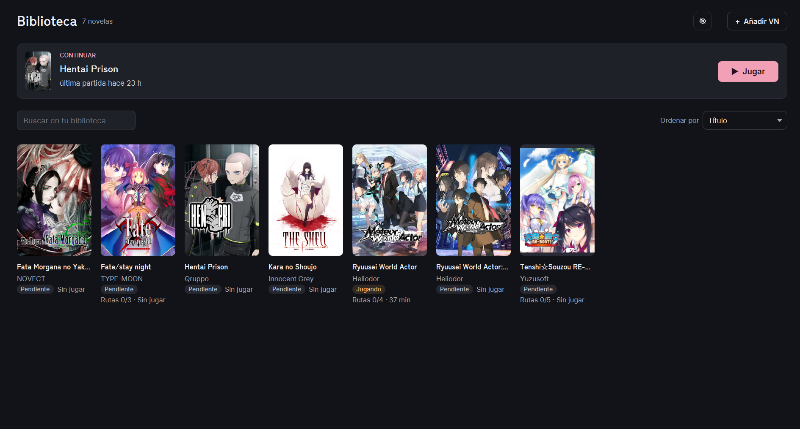
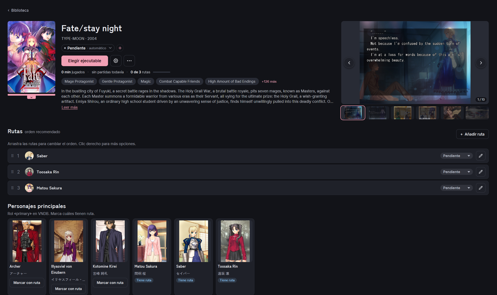

<h1 align="center">
  <picture>
    <source media="(prefers-color-scheme: dark)" srcset="docs/design/logo/vn-launcher-logo-dark.svg">
    
  </picture>
</h1>

<p align="center">
  <a href="https://github.com/JulioInAction/vn-launcher/releases/latest">
    
  </a>
  <a href="https://github.com/JulioInAction/vn-launcher/releases">
    
  </a>
  
  
  <a href="LICENSE">
    
  </a>
</p>

<p align="center">
  Biblioteca, launcher y contador de tiempo de juego para novelas visuales, con los datos de
  <a href="https://vndb.org">VNDB</a>. Hecho con Java y JavaFX.
</p>





## Qué es

VN Launcher reúne en un mismo sitio todas tus novelas visuales, las compraras donde las compraras.
Muchas no están en Steam, así que acaban repartidas entre carpetas, tiendas japonesas y discos
externos, y cuesta acordarse de cuál ibas jugando o qué rutas te quedaban.

Buscas la novela en VNDB, la añades a la biblioteca, le dices dónde está su `.exe` y a partir de ahí
la abres desde la app. Ella se encarga de contar el tiempo que juegas, de guardar qué rutas has
terminado y, si hace falta, de lanzarla con Locale Emulator para que el texto japonés no salga roto.

## Funciones

- Busca novelas en VNDB y mira su ficha antes de añadirlas
- Biblioteca en cuadrícula de portadas, con buscador, filtros por estado y por etiqueta y varias formas de ordenar
- Estados automáticos según lo que juegas (Jugando, Pendiente, Completada), o fijados a mano, también En pausa y Abandonada
- Estanterías propias con colores, para organizarla a tu manera
- Ficha de cada novela con descripción, etiquetas, capturas y sus personajes principales
- Rutas de cada heroína en el orden que quieras, marcando las que llevas y las que has terminado
- Lanza los juegos directamente, con Locale Emulator si los necesitan, y abre su programa de configuración
- Cuenta las partidas y el tiempo total de juego de cada novela
- Puedes cambiar la portada por la de otra edición o por una imagen tuya
- Tema claro y oscuro, o el que tenga el sistema
- Guarda en local las portadas y los datos de VNDB, así que la biblioteca se ve igual sin conexión
- Copias de seguridad automáticas y exportar o importar todo tu perfil en un `.zip`
- Avisa cuando sale una versión nueva

## Plataformas

- **Windows 10 y 11 (64 bits).** Es para lo que está pensada y lo único que tiene instalador.
- **Linux:** se puede arrancar desde el código, pero lanzar juegos de Windows todavía no funciona,
  porque no usa Wine ni Proton.

## Instalación

### Windows

```
# 1. Descarga el instalador (VN-Launcher-x.y.z.exe) de la última release y ábrelo.
# 2. El instalador no está firmado, así que SmartScreen avisará la primera vez:
#    «Más información» → «Ejecutar de todas formas».
```

Se instala solo para tu usuario, sin pedir permisos de administrador, y lleva su propio Java dentro,
así que no hace falta tener nada más instalado. Para actualizar basta con instalar la versión nueva
encima: tus datos se quedan donde estaban.

### Locale Emulator (opcional)

Algunas novelas japonesas solo funcionan bien con el sistema en japonés. Si es tu caso, instala
[Locale Emulator](https://github.com/xupefei/Locale-Emulator), indica en Ajustes dónde está
`LEProc.exe` y actívalo en las opciones de cada juego que lo necesite.

## Compilar desde el código

### Requisitos

- JDK 26
- Maven 3.9 o posterior
- Para el instalador de Windows, además, WiX Toolset 3:

```
winget install --id WiXToolset.WiXToolset
```

### Compilar

```
# Ejecutar los tests
mvn test

# Arrancar la aplicación
mvn javafx:run

# Crear el instalador (sale en target/instalador)
mvn clean package -P instalador

# Sin WiX: versión portable, una carpeta con «VN Launcher.exe»
mvn clean package -P instalador -Djpackage.options=src/packaging/windows/portable.txt
```

## Dónde se guardan los datos

En Windows, en `%LOCALAPPDATA%\VNLauncher` (en Linux, en `~/.vnlauncher`):

```
VNLauncher/
├── library.db    # la biblioteca, las rutas, el tiempo de juego y los ajustes (SQLite)
├── images/       # portadas y capturas descargadas de VNDB (se puede vaciar desde Ajustes)
├── covers/       # las portadas que eliges tú
├── backups/      # copias de seguridad automáticas (se guardan las 5 últimas)
└── logs/         # registro de errores
```

Desinstalar la app no borra esta carpeta.

## Próximamente

- Traducción completa al inglés
- Cambiar el tamaño de las portadas de la biblioteca con un deslizador
- Descargar e instalar las actualizaciones desde la propia app
- Discord Rich Presence, para que se vea en tu perfil a qué estás jugando
- Sincronizar con tu lista de VNDB
- Versión para Steam Deck, algún día

## Tecnologías

- Java 26 y JavaFX 26
- SQLite (con `sqlite-jdbc`) y migraciones propias
- Jackson para leer la [API de VNDB](https://api.vndb.org/kana)
- `jlink` y `jpackage` (con WiX) para el instalador

## Documentación

- [`CHANGELOG.md`](CHANGELOG.md): los cambios de cada versión
- [`docs/development.md`](docs/development.md): cómo funciona por dentro (tiempo de juego, copias de seguridad, perfiles, búsqueda…)
- [`docs/design.md`](docs/design.md): la guía visual, con colores, tipografía y componentes

## Licencia

VN Launcher es software libre con licencia [MIT](LICENSE).

Los datos y las imágenes de las novelas vienen de [VNDB](https://vndb.org) y siguen sus condiciones
de uso; este proyecto no tiene relación oficial con VNDB. Locale Emulator (LGPL-3.0) no va incluido:
lo instalas tú y la app solo lo ejecuta. Las fuentes Inter y Zen Kaku Gothic New tienen licencia
SIL Open Font License 1.1. El resto de licencias de lo que lleva dentro está en
[`docs/development.md`](docs/development.md#licencias).
